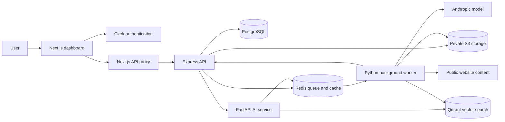
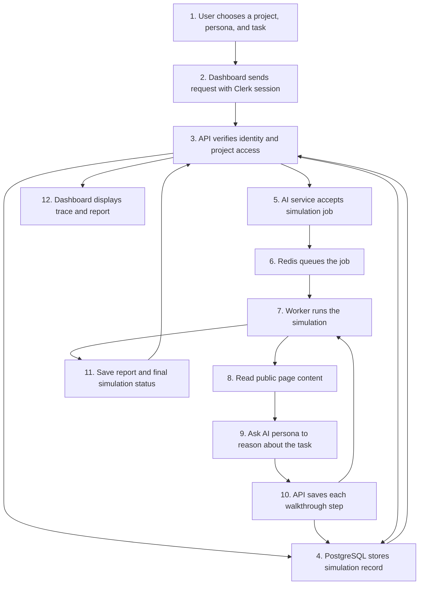
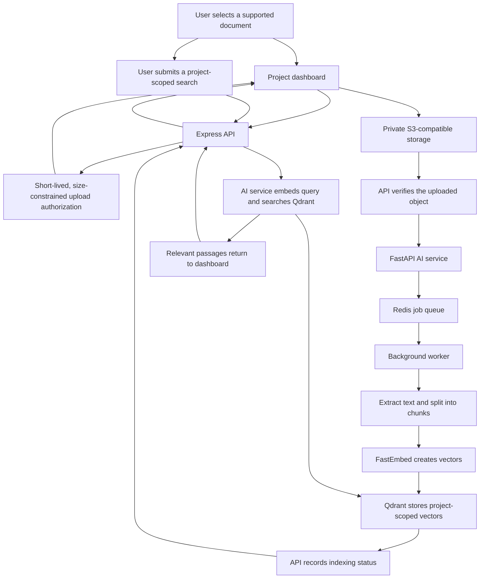

# ShadowTest

**Find product friction before it costs you customers.**

ShadowTest helps product teams explore how people might experience a website
before spending days arranging interviews or waiting for the next round of user
research. Describe a product, choose a synthetic persona, set a task, and get an
AI-generated, step-by-step walkthrough with a summary of possible friction.

> **In plain English:** ShadowTest is a practice audience for your product. It
> helps you spot questions and usability risks worth investigating with real
> users—not replace real users.

**Early access** · Next.js · TypeScript · FastAPI · PostgreSQL · Redis

---

## The problem

Building a product is fast. Learning where people get confused can be slow.
Traditional usability research is valuable, but coordinating participants,
scheduling sessions, and reviewing feedback takes time. Small teams may not
have a research team or budget for every design decision.

That creates a difficult choice: ship based on assumptions, or delay decisions
while waiting for more feedback.

## How ShadowTest helps

ShadowTest gives teams a quick way to examine a product journey and generate
research prompts:

1. **Create a project** and optionally provide a public HTTPS product page or a
   public GitHub repository.
2. **Choose a persona**—for example, an impatient developer or a cautious
   enterprise buyer—or create one that fits your audience.
3. **Describe a task** such as finding a feature, understanding a price, or
   starting a workflow.
4. **Review the walkthrough.** ShadowTest records what the synthetic persona
   notices, how it interprets the page, and where it encounters potential
   friction.
5. **Use the report to decide what to investigate next.** Review the run with
   your team and validate important conclusions with real users.

The evaluator reads public page content and may follow links on the same host.
It does **not** click controls, submit forms, sign in, or make changes to the
product being reviewed.

## Does it save time and money?

It can help teams get an early signal sooner and reduce the effort needed to
prepare an initial list of questions to investigate. That may help a team avoid
spending engineering time on an assumption that deserved a closer look.

We do not claim a guaranteed dollar amount, research-time reduction, or
conversion lift. Results depend on the product, task, and persona, and AI
walkthroughs can be wrong or incomplete. Treat them as hypotheses—not measured
customer evidence.

Teams can estimate their own potential value:

> **Potential time returned** = research-preparation hours avoided or
> repurposed × the team's hourly cost

For example, compare the time spent setting up and reviewing a ShadowTest run
with the time your team would otherwise spend preparing an early exploratory
review. Track the result over several projects before making an ROI claim.

## Who it is for

- **Founders and entrepreneurs:** pressure-test an idea or onboarding journey
  before committing a sprint to changes.
- **Product managers and designers:** get another structured perspective while
  shaping flows, messaging, and feature discoverability.
- **Developers:** connect a reported friction point to a concrete product task
  and decide what to verify next.
- **Researchers:** use synthetic walkthroughs to generate interview questions
  and hypotheses alongside—not instead of—research with people.
- **Recruiters and HR teams:** understand how a public careers page or
  application-information page may read to different audiences. ShadowTest
  evaluates product content; it is **not** a candidate-screening, employee
  assessment, or hiring recommendation system.
- **Anyone curious about a website:** describe a goal in everyday language and
  review a plain-language walkthrough.

## What you can do

- Organize product reviews into projects and create custom personas.
- Run asynchronous, read-only AI walkthroughs and inspect saved steps and
  reports.
- Upload private PDF, Markdown, and plain-text project documents to provide
  searchable background context for simulations.
- Search indexed project documents for relevant passages.
- Collaborate in Clerk organizations, subject to your workspace configuration.
- Browse large project, persona, simulation, report, and document lists with
  cursor-based pagination.
- Export reports to CSV.
- Use Redis-backed job queues, retry failed simulations, and apply plan limits.
- Optionally connect Stripe subscriptions.

## System Architecture

### High-Level Design (HLD)

This overview shows how the user-facing application, backend, AI services, and
data stores work together. The web app sends dashboard requests through its
same-origin API proxy. The API handles identity, access, persistence, and job
dispatch. A background worker processes longer-running simulations and
document-indexing jobs.



### Low-Level Design (LLD)

#### Simulation lifecycle



The worker repeats the page-inspection and reasoning steps until it reaches a
result or the run's step limit. Page inspection is read-only: it does not sign
in, click controls, or submit forms.

#### Document upload and semantic search



Uploads are limited to PDF, Markdown, and plain text, up to 10 MB per file.
Search results are scoped to the selected project.

## Technology

| Layer | Technology | Responsibility |
|---|---|---|
| Web | Next.js, React, TypeScript | Dashboard, project workflows, and API proxy |
| Authentication | Clerk | User sessions and organization membership |
| Application API | Node.js, Express, Prisma | Authenticated routes, validation, access checks, and persistence |
| Database | PostgreSQL | Users, projects, personas, simulations, steps, reports, and documents |
| Queue and cache | Redis | Background jobs, short-lived API response cache, and rate-limit storage |
| AI service and worker | Python, FastAPI | Read-only page inspection, simulation jobs, and document processing |
| Language model | Anthropic API | Persona reasoning and generated walkthrough content |
| File storage | S3-compatible object storage | Private source documents |
| Semantic search | Qdrant and FastEmbed | Vector indexing and project-scoped passage retrieval |
| Hosting blueprint | Vercel and Render | Web app and backend services |

## Getting started

### Requirements

- Node.js 20 or later and npm
- Python 3.11 for the AI service
- PostgreSQL and Redis
- Clerk credentials for authenticated dashboard use
- An Anthropic API key for live AI simulations
- For document search: an S3-compatible bucket and Qdrant instance

### Configure environment

Copy the relevant examples and fill in local values:

```sh
cp api/.env.example api/.env
cp ai-engine/.env.example ai-engine/.env
cp web/.env.example web/.env.local
```

Set database, Redis, Clerk, internal service authentication, and AI credentials
as appropriate. Never commit real `.env` files or expose secrets through
`NEXT_PUBLIC_*` variables. Document storage and vector search require their own
AWS/S3 and Qdrant configuration.

### Start services locally

Install and launch the API:

```sh
cd api
npm ci
npm run build
npm run migrate:deploy
npm start
```

In another terminal, install and launch the AI API:

```sh
cd ai-engine
python3.11 -m venv .venv
source .venv/bin/activate
python -m pip install -r requirements.txt
uvicorn main:app --reload --host 0.0.0.0 --port 8000
```

In a third terminal, start the background worker:

```sh
cd ai-engine
source .venv/bin/activate
python worker.py
```

In a fourth terminal, start the web app:

```sh
cd web
npm ci
npm run dev
```

Open [http://localhost:3000](http://localhost:3000). Set
`API_SERVER_URL=http://localhost:4000/api` in `web/.env.local` for local API
requests. The API needs the PostgreSQL and Redis services running first; set the
same internal API key on the API, AI service, and worker.

### Tests and builds

```sh
cd api && npm test
cd web && npm run lint && npm run build
cd ai-engine && python -m unittest discover -s . -p 'test_*.py'
```

## Deploying

See [DEPLOYMENT.md](./DEPLOYMENT.md) for the full Render, Vercel, PostgreSQL,
Clerk, Redis, S3, Qdrant, and optional Stripe setup.

The checked-in Render blueprint provisions the API, AI service, worker, and
Redis. It does not create external PostgreSQL, Clerk, Anthropic, AWS, or Qdrant
accounts for you. Deploy the backend first, then configure Vercel's
`API_SERVER_URL` to the actual public API URL ending in `/api`. Verify the API
service's `/health` endpoint before using dashboard features.

## Trust, safety, and current limits

- **A research aid, not ground truth:** AI-generated observations are
  suggestions to verify, not evidence that real customers behave the same way.
- **Read-only evaluation:** ShadowTest inspects page text and same-host links;
  it does not operate controls, submit forms, or modify target sites.
- **Public pages only:** Evaluated pages must be publicly reachable over HTTPS.
  Login-only and private application flows are not evaluated.
- **Document formats and size:** PDF, Markdown, and plain-text uploads are
  supported, up to 10 MB per file. PDF text extraction does not include OCR.
- **Team access:** Organization access depends on Clerk Organizations being
  enabled and configured for the deployed Clerk instance.
- **External services required:** Live use depends on correctly configured
  database, identity, AI, queue, and deployment credentials. S3/Qdrant are
  additionally required for document upload and semantic search.
- **Not a hiring tool:** Do not use persona output to score, rank, or make
  employment decisions about people.

## Repository layout

```text
web/         Next.js dashboard and same-origin API proxy
api/         Express API, Prisma schema, and database migrations
ai-engine/   FastAPI service, simulation logic, document processing, and worker
render.yaml  Render services and environment-variable blueprint
DEPLOYMENT.md
             External-service configuration and deployment walkthrough
```

## Contributing

Issues and pull requests are welcome. For substantial changes, please describe
the user problem, expected behavior, and how you tested the change. Never
include customer data, credentials, or private documents in issues or test
fixtures.

---

*Built to help teams ask better product questions earlier—and validate the
important answers with people.*